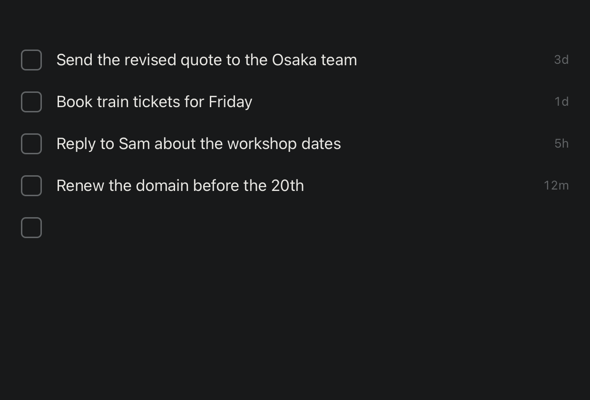
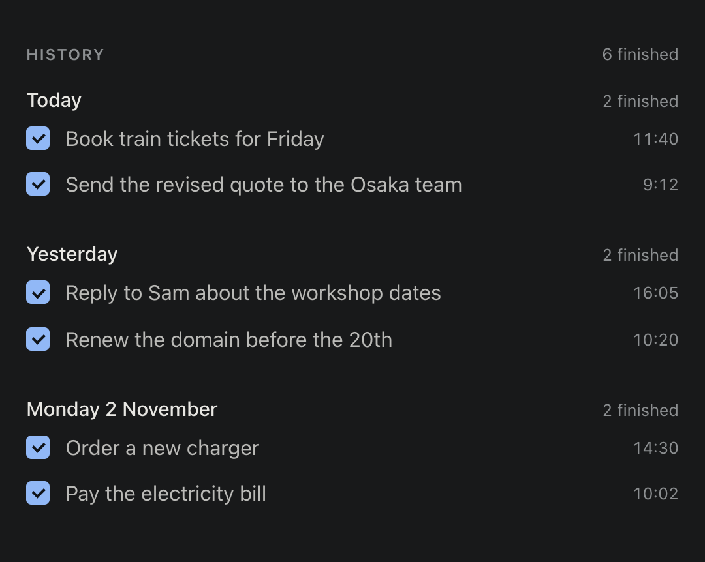

# Focus Zen

[](https://github.com/adusingi/focus-zen/actions/workflows/ci.yml)
[](LICENSE)

A quiet desktop checklist for follow-ups. Type a line, press Enter, tick it off when it is done. Nothing else on the screen.

Built with [Tauri 2](https://tauri.app) and Rust. Items are stored locally in SQLite. There is no account, no sync, and no network access.



## Download

Get the `.dmg` from the [latest release](https://github.com/adusingi/focus-zen/releases/latest). It runs on Apple Silicon and Intel Macs with macOS 12 or later.

1. Open the `.dmg` and drag **Focus Zen** into **Applications**.
2. Open Focus Zen. The app is not notarized by Apple, so macOS blocks the first launch:
   - **macOS 15 or later:** click **Done**, open **System Settings → Privacy & Security**, scroll down, and click **Open Anyway**.
   - **macOS 14 or earlier:** right-click the app, choose **Open**, then click **Open**.

You can also clear the block in Terminal: `xattr -dr com.apple.quarantine "/Applications/Focus Zen.app"`

## Use it

| Action | How |
| --- | --- |
| Open the list from any app | Press <kbd>⌥</kbd> <kbd>Space</kbd>. The cursor is on the empty line |
| Add an item | Type on the empty line, then press <kbd>Enter</kbd> |
| Close the list | Press <kbd>Esc</kbd> on the empty line, or <kbd>⌥</kbd> <kbd>Space</kbd> again. You go back to the app you were in. Text you typed but did not save with Enter is saved |
| Move between lines | Press <kbd>↑</kbd> or <kbd>↓</kbd> |
| Edit an item | Click its text, or move to it with <kbd>↑</kbd>. Change it, then press <kbd>Enter</kbd> |
| Cancel an edit | Press <kbd>Esc</kbd> |
| Finish an item | Click its checkbox, or press <kbd>⌘</kbd> <kbd>Enter</kbd> on its line |
| See what you finished | Click the menu bar icon and choose **History…**, or press <kbd>⌘</kbd> <kbd>Y</kbd> |
| Find a finished item | In History, type in the search field (<kbd>⌘</kbd> <kbd>F</kbd>) |
| Hide the list | Close the window. Focus Zen keeps running in the menu bar |
| Bring the list back | Click the menu bar icon and choose **Open Focus Zen** |
| Quit | Click the menu bar icon and choose **Quit Focus Zen**, or press <kbd>⌘</kbd> <kbd>Q</kbd> |

Each item shows how long ago you added it: `now`, then minutes (`12m`), hours (`5h`), and days (`3d`) after 24 hours. Hover the age to see the exact date and time.

If another app already uses <kbd>⌥</kbd> <kbd>Space</kbd>, Focus Zen cannot use it. Open the list from the menu bar icon instead.

Finished items leave the list. They stay in the database with a `completed_at` timestamp, next to the `created_at` timestamp of every item. **History** shows them on a calendar: each day has a dot, larger and brighter when you finished more that day. Click a day (or use the arrow keys) to see what you finished then, or search all finished items. Hover an item to see when it was added and finished.



While the list window is closed, Focus Zen has no Dock icon. It shows only in the menu bar, next to Wi-Fi and Bluetooth.

## Run from source

### Prerequisites

- [Rust](https://www.rust-lang.org/tools/install) (stable)
- [Node.js](https://nodejs.org) 22.13 or later
- [pnpm](https://pnpm.io/installation) 11
- The system packages that Tauri needs for your OS: see [Tauri prerequisites](https://v2.tauri.app/start/prerequisites/). On macOS this is the Xcode Command Line Tools (`xcode-select --install`).

### Clone and start

```sh
git clone https://github.com/adusingi/focus-zen.git
cd focus-zen
pnpm install
pnpm tauri dev
```

The first start compiles the Rust side, so it takes a few minutes. Later starts are fast.

To work on the UI only, run `pnpm dev` and open <http://127.0.0.1:1420>. In a normal browser the app stores items in `localStorage` instead of SQLite.

## Build the app

```sh
pnpm tauri build
```

The app and its installer are written to `src-tauri/target/release/bundle/`. On a Mac you get `Focus Zen.app` and a `.dmg`.

The macOS build is signed ad hoc and is not notarized. It opens normally on the Mac that built it. On another Mac, Gatekeeper blocks the first launch; see [Download](#download) for how to open it.

## Release

1. Set the same new version in `package.json`, `src-tauri/Cargo.toml`, and `src-tauri/tauri.conf.json`, then commit.
2. Tag that commit and push the tag:

   ```sh
   git tag vX.Y.Z           # the version you just set, e.g. v0.4.0
   git push origin vX.Y.Z
   ```

The [Release workflow](.github/workflows/release.yml) builds a universal `.dmg` (Apple Silicon and Intel), checks it, and publishes it with a SHA-256 checksum as a GitHub Release. It stops if the tag and the three versions do not match.

## Where your data lives

The database file is `focus-zen.db` in the app's config folder:

| OS | Folder |
| --- | --- |
| macOS | `~/Library/Application Support/com.focuszen.desktop/` |
| Linux | `~/.config/com.focuszen.desktop/` |
| Windows | `%APPDATA%\com.focuszen.desktop\` |

**Settings → Database** shows the exact path and has a **Show in Finder** button.

Each computer keeps its own list. To move your list to another computer, quit Focus Zen first (menu bar icon → **Quit Focus Zen**; closing the window is not enough), then copy that folder.

## Project layout

```text
src/                     List window: index.html, styles.css, app.js (plain JavaScript, built by Vite)
src/history.*            History window: a month calendar, the chosen day, and search
src/settings.*           Settings window: the database location
src/lib/                 Shared code: the database repository and the History date helpers (with tests)
src-tauri/src/           Rust app: windows, menu bar icon, macOS app menu, database location
src-tauri/migrations/    SQL migrations, applied on start
src-tauri/capabilities/  Permissions per window (only the list window can write)
site/                    The website at focus.mobayilo.com (see Website)
```

## Website

The landing page at <https://focus.mobayilo.com> lives in `site/`: plain HTML and CSS on the Mobayilo design system (the `focus-zen` theme), with self-hosted fonts and no JavaScript. Vite fingerprints the assets, and Cloudflare serves the result as a static-assets Worker on the custom domain.

| Page | Purpose |
| --- | --- |
| `site/index.html` | The home page. **Support & download ($5)** opens the Stripe payment link; **or get it free on GitHub** opens the latest release. |
| `site/thanks.html` | Where Stripe sends buyers after payment (`/thanks`): the download and the install steps. |
| `site/404.html` | Shown for any unknown address. |

```sh
pnpm site:dev      # http://127.0.0.1:1430
pnpm site:deploy   # build site/dist, then deploy to focus.mobayilo.com (needs `pnpm exec wrangler login`)
```

The download link on `site/thanks.html` names the release (`v0.3.0`). Update it with each release, and deploy the site only after the release is published.

## Contributing

Issues and pull requests are welcome. Before you open a pull request, run the same checks as CI:

```sh
pnpm test
pnpm build
cd src-tauri
cargo fmt --check
cargo clippy --all-targets --locked -- -D warnings
cargo test --locked
```

## App icon

The icon is a Tai-Chi practitioner in black ink on warm paper. `src-tauri/icons/icon-source.png` is the 1024 × 1024 master on the macOS icon grid. To make every platform size again after you change it:

```sh
pnpm tauri icon src-tauri/icons/icon-source.png
```

The menu bar icon is separate: `src-tauri/icons/tray-template.svg`, rendered to `tray-template.png` (36 × 36, black on transparent).

## License

[MIT](LICENSE) © 2026 Aimable Dusingizimana
